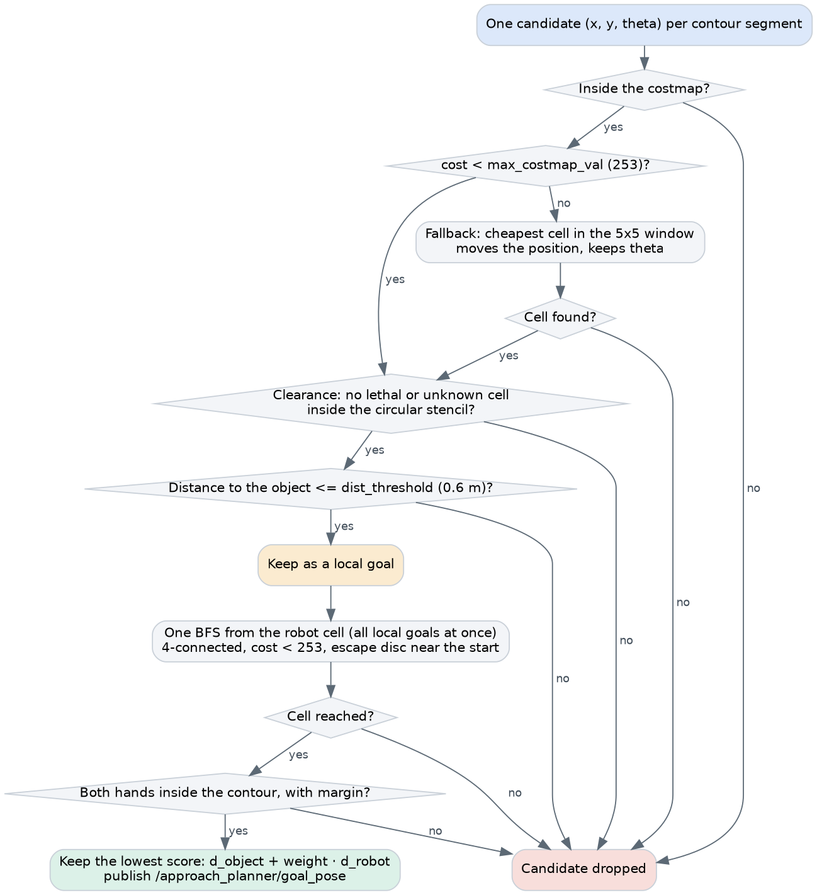
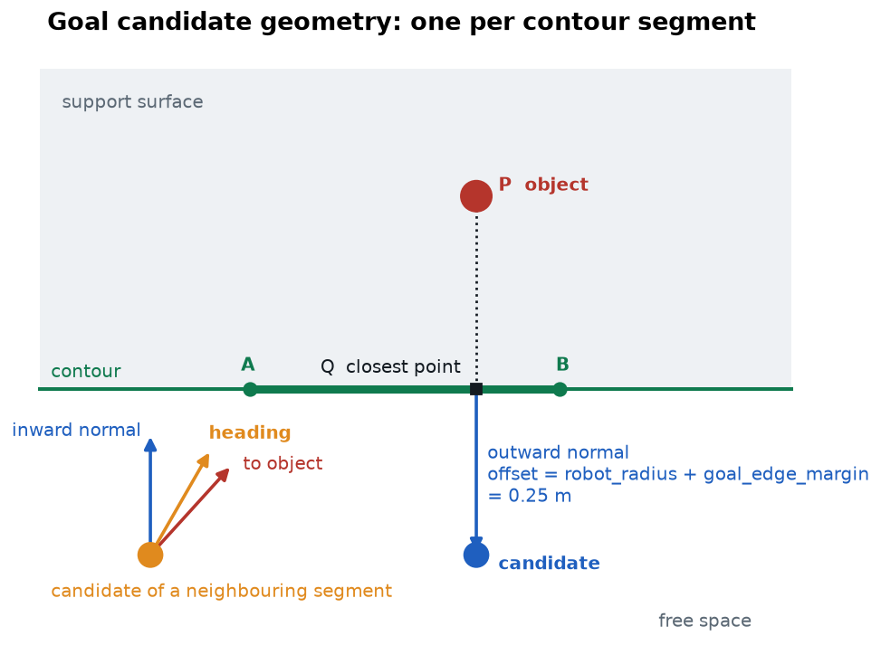
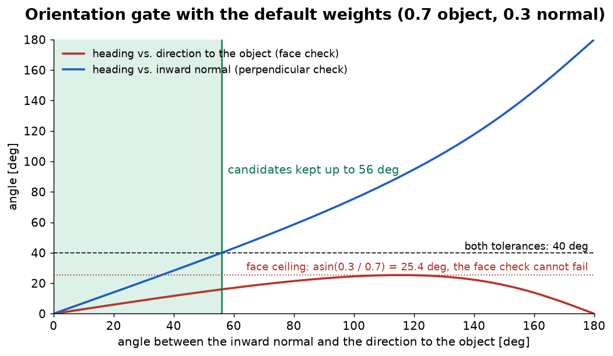
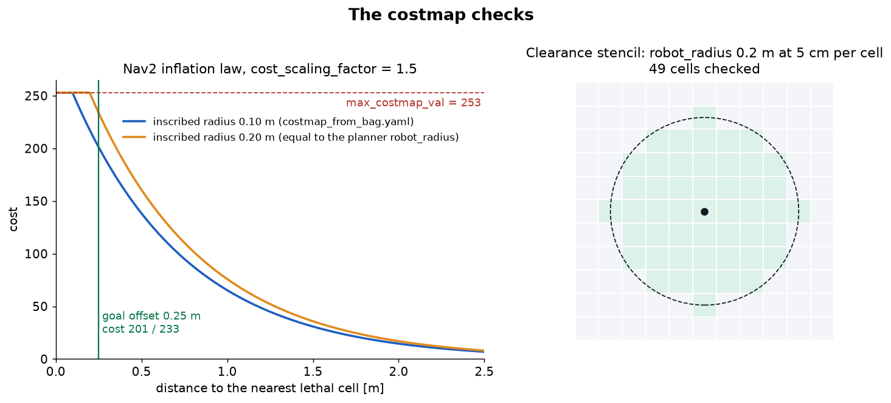
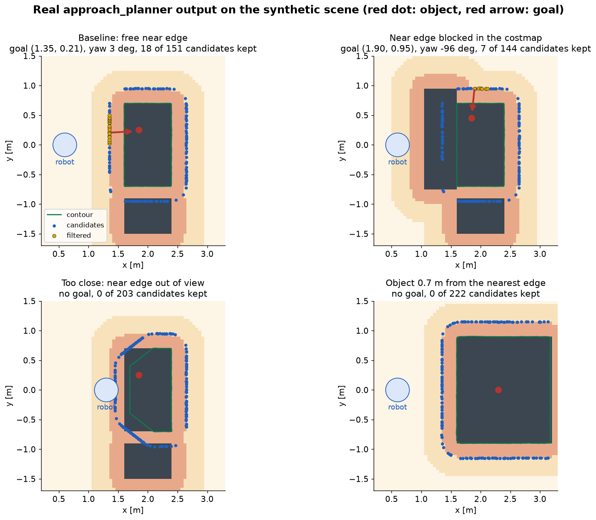

# Approach planning

From a surface contour to one goal pose: where to stand and which way to face.
Code: `contours_update` in `approach_path_planning/src/planner.cpp`.

Note that `approach_planner` publishes a pose. It computes no path, and it sends nothing to Nav2:
the [detector forwards the goal](request_lifecycle.md#3-goal-forwarding).

---

## 1. The problem

A good stance satisfies four requirements at once:

| Requirement | Enforced by |
|---|---|
| **Near**: the object is within arm's reach. | `dist_threshold` |
| **Clear**: the body does not touch the surface or anything else. | Contour offset, costmap cost, clearance check |
| **Reachable**: Nav2 can drive there from here. | Breadth-first search on the costmap |
| **Well oriented**: the robot faces the object and squarely faces the edge. | Heading blend and orientation gate |
| **Hands over the surface**: both hands end up inside the contour. | Hand check on each candidate |

The method is generate and test: produce one candidate per contour segment, discard those that fail,
then choose among the survivors.



---

## 2. Preparing the inputs

Each `DetectionResults` message triggers one planning cycle. A contour with fewer than 3 points is
ignored. The contour, object and robot pose are transformed to `map`. The robot pose is looked up at
the object's stamp, so the plan is consistent with the frame it came from.

**Polygon orientation.** The contour's vertex order is arbitrary, and the planner needs to know which
side of each segment is outside. It uses the sign of the area from the shoelace formula:

```text
A = 1/2 · Σ (x_i · y_i+1 - x_i+1 · y_i)        A > 0: counter-clockwise
```

Walking counter-clockwise, the interior lies on the left, so the outward normal of a segment points
to the right. If `A < 0`, this flips. Unlike a test against the polygon's centroid, this stays
correct for concave shapes.

---

## 3. Generating candidates

For each contour segment `AB`, with object position `P`:

```text
t  = clamp( (P - A)·(B - A) / |B - A|², 0, 1 )      projection of P on the segment
Q  = A + t (B - A)                                  closest point to P on AB
C  = Q + n_out · (robot_radius + goal_edge_margin)  candidate position
```



The offset defaults to 0.20 + 0.05 = 0.25 m. Segments of zero length are skipped, which removes the
repeated closing vertex.

**This produces a band, not one point.** The original idea was that `Q` is the best place to reach
from, as it is the closest point on each edge. That holds for a long straight segment. A real
alpha-shape contour has many short segments: 160 vertices on a 4.4 m perimeter in the synthetic
baseline, or about 3 cm each. On a short segment, clamping pins `Q` inside the segment, so nearby
segments each yield a candidate of their own. In practice, the candidates trace the contour at a
fixed offset, and the reach filter and the selection step do the real choosing.

---

## 4. Orientation

With `enable_window_tangent_orientation: false`, the heading is simply the inward normal of the
segment, and every candidate is valid. The default mode blends two aims.

**Smoothed normal.** Short segments of a noisy contour have noisy directions. The tangent at vertex
`i` is estimated from a symmetric window of `orientation_window_size` vertices on each side:

```text
T = normalise( Σ_r=1..w  (p[i+r] - p[i-r]) )
```

Note that the window counts vertices, not metres, so its physical length depends on contour density.
The inward normal `n_in` follows from `T`. This smoothing affects orientation only: the position in
step 3 uses the raw segment normal.

**Heading blend.** With `u` the unit vector from the candidate to the object:

```text
d = normalise( w_o · u + w_n · n_in )       w_o = 0.7, w_n = 0.3
theta = atan2(d.y, d.x)
```

Facing the object keeps it in the camera's view and centred for the arms. Facing the edge squarely
keeps the torso parallel to the table, so both arms have similar reach. The blend trades one against
the other. For a candidate with the object 31.8° from the normal, this formula gives 22.4°.

**The gate.** A candidate is then kept only if:

```text
d · u     >= cos(orientation_face_tolerance_deg)     the heading faces the object
|d · T|   <= sin(orientation_perp_tolerance_deg)     the heading is near the edge normal
```

**What the gate actually does with the defaults.** Let `φ` be the angle between `n_in` and `u`. Since
`d` lies between them, the two checks split `φ` into `α` (heading to object) and `β` (heading to
normal). Two results follow:

- A weighted sum cannot stray from its larger component by more than `asin(w_n / w_o)`, when
  `w_n < w_o`. With 0.7/0.3, that is **25.4°, so the 40° face check can never fail**. It becomes
  active only below 25.4°, or with a larger `w_n`.
- The perpendicular check has a real limit. `β ≤ 40°` gives **`φ ≤ 56°`**: a candidate survives only
  if the object is within 56° of straight ahead of the edge normal.



---

## 5. Costmap checks

**Background: configuration space.** Collision checking a robot's body at every position is
expensive. For a round robot, an equivalent test is to grow every obstacle by the robot's radius and
then treat the robot as a point. This is the configuration-space idea (Lozano-Pérez, 1983), and it is
what a Nav2 inflation layer provides. Each cell's value depends on its distance `d` from the nearest
obstacle:

```text
254                                  d = 0              LETHAL_OBSTACLE
253                                  d <= r_inscribed   INSCRIBED_INFLATED_OBSTACLE
252 · exp(-k (d - r_inscribed))      d > r_inscribed    k = cost_scaling_factor
255                                                     NO_INFORMATION (unknown)
```

The exponential tail is a soft preference for staying away from obstacles. The band up to
`r_inscribed` is the hard collision limit for the robot's centre.

The checks below run in sequence on each candidate.

**Cost gate.** The candidate's cell must have a cost below `max_costmap_val`. The default 253 rejects
inflated, lethal and unknown cells, and accepts the soft tail. At the 0.25 m offset the cost is about
201 with the 0.1 m radius in `costmap_from_bag.yaml`, or 233 with a 0.2 m radius.

**Fallback.** A cell failing the gate gets one more chance. `findNearestFreeCell` scans the 5×5 window
around it and picks the lowest-cost cell. Despite its name, it minimises cost, not distance, so the
position can move by up to 14 cm in any direction. `theta` is not recomputed, so the heading then
refers to the original position.

**Clearance check.** Costs describe the costmap's idea of the robot, which may be a smaller radius
than the planner's. So the planner tests its own circle: no lethal or unknown cell within
`goal_clearance_radius_cells`, or `robot_radius / resolution` when that is `-1`. Inflated cells pass,
to avoid counting the robot's size twice.

The automatic radius includes a small tolerance. `CostmapMetaData.resolution` is a `float32`, so
0.2 / 0.05 evaluates to 3.99999994 without it, and the cells exactly 0.2 m away along the axes would
be skipped.



**Reach check.** The distance from the (possibly moved) position to the object must not exceed
`dist_threshold`. With an object `e` behind the edge, the closest possible stance is `e + 0.25` m from
it, so objects deeper than **0.35 m from every edge cannot be approached** with the defaults.

---

## 6. Reachability: breadth-first search

A cell can be free but enclosed, for example behind a wall or in a gap between tables.
`computeReachableCells` floods the costmap from the robot's cell:

```text
queue = [robot cell]
while queue is not empty and targets remain:
    expand the 4 neighbours of the next cell, if traversable and unseen
```

**Why BFS and not A\*.** There are many targets and the question is yes or no for each, not the
shortest path. A single BFS answers for all of them in `O(cells)`, and stops once all are found,
while one A\* per candidate would repeat most of the work. Earlier versions used A\*.

**Traversable cells.** A cell is traversable if `cost < max_costmap_val`. With a properly inflated
costmap, this is exactly the configuration-space test above.

**The escape disc.** The robot often starts inside the inflated band, for example while refining a
goal near the table. A strict test would then find its own start cell's neighbours blocked and
declare everything unreachable. So within `robot_radius` of the start, inflated and unknown cells
also count as traversable. Lethal cells never do.

Grid limitations make this check slightly conservative compared with a Nav2 planner: moves are
4-connected, so a passage open only diagonally is closed, and unknown cells block the search outside
the disc, even where the Nav2 planner has `allow_unknown` enabled.

---

## 6b. Hands over the surface

If the robot walks up to a table with its hands outside the edge, the arms end up trapped against it and
cannot reach the object without a collision. So a stance is valid only if both hands end up over the
surface. The hand position follows from the candidate pose `(x, y, θ)`:

```text
hand = (x, y) + R(θ) · (hand_forward_offset, ± hand_lateral_offset)
```

Each hand must be inside the contour (even-odd rule), and at least `hand_surface_margin` from every
contour segment. The check uses the same contour as everything else, so a virtual edge makes it
stricter, not looser.

With the defaults, the hands are 0.15 m past the edge on a straight approach. The check matters near
corners and on oblique stances. In the "near edge blocked" scene, the previous goal at x = 1.76 m left
the right hand off the table, and the goal moved to x = 1.90 m.

This check covers the final stance only. Raising the hands before the robot gets close is done by the
detector: see [request lifecycle](request_lifecycle.md#2b-raising-the-hands). The offsets must match
between the two nodes.

The offsets are placeholders, not measured from the robot. Set them from the real pre-grasp pose.

---

## 7. Selection

Among the survivors, the planner picks the pose with the lowest score, with `λ` set by
`goal_robot_distance_weight` (default 0.25):

```text
score = d_object + λ · d_robot
```

Both distances are straight lines in the plane, and `d_object` is measured to the object's centroid.

**Why the object comes first.** The reach check is a limit, not a target: a pose just inside it passes
but leaves no margin for the error in the centroid or for navigation tolerance. Minimising `d_object`
places the robot in front of the object, and because this does not depend on where the robot is, the
goal also moves less during the drive.

**Why the robot term exists.** On a narrow table, poses on opposite sides can be almost equally close
to the object, and the robot should not walk around the table for a marginal gain. A pose on the far
side wins only if:

```text
d_object gain > λ · extra straight-line distance
```

At the default, a pose must be 25 cm closer to the object to justify 1 m more distance.

| `λ` | Behaviour |
|---|---|
| `0` | Closest to the object, wherever that is. Can pick the far side for a tiny gain. |
| `0.25` | In front of the object, on the robot's side of the surface. |
| Large | Closest to the robot. Only reach-limited, so the robot can stop well to the side of the object. |

**Measured effect.** On a straight edge, the reach check keeps a band centred on the object, with
half-width `sqrt(0.6² - D²)`, where `D` is the distance from the candidate line to the object. In the
synthetic baseline, `D = 0.47` m predicts a band from y = −0.13 to 0.61, and the planner kept y = −0.12
to 0.58. The table compares the real planner at two weights, with the object at y = 0.25:

| | `λ = 0.25` | `λ = 1000` (closest to the robot) |
|---|---:|---:|
| Goal y | 0.21 | −0.05 |
| Distance to the measured centroid | 0.47 m | 0.56 m |
| Distance to the cup's true axis | 0.50 m | 0.58 m |
| Straight-line distance from the robot | 0.78 m | 0.75 m |
| Goal y from robot positions along the drive | 0.22, 0.22, 0.15 | −0.01, 0.04, −0.08 |

The closest pose in this scene is 0.47 m from the centroid: the object is 0.22 m behind the edge, and
the robot stands 0.25 m in front of it. Selection cannot do better than that, so objects deep on a
surface still have a small reach margin.

See [L3](known_limitations.md#l3-reach-ignores-height-and-the-arms) for what this score does not model.

---

## 8. Worked examples

All of these are real `approach_planner` outputs, from a synthetic scene: a 0.8 × 1.4 m table with
its near edge at x = 1.6 m, a 0.75 m top, a second desk beside it, and an 8 cm cup. Blue dots are
candidates, yellow are survivors, and the red arrow is the goal.



| Scene | Robot | Object | Candidates kept | Goal | To object |
|---|---|---|---:|---|---:|
| Baseline | (0.60, 0.00) | (1.85, 0.25) | 18 of 151 | (1.35, 0.21), 3° | 0.50 m |
| Straight on | (0.60, 0.25) | (1.85, 0.25) | 18 of 160 | (1.35, 0.27), −2° | 0.50 m |
| Near edge blocked | (0.60, 0.00) | (1.85, 0.45) | 7 of 144 | (1.90, 0.95), −96° | 0.50 m |
| Narrow table, 0.5 m deep | (0.60, 0.00) | (1.90, 0.25) | 35 of 117 | (1.35, 0.19), 5° | 0.55 m |
| Too close | (1.30, 0.00) | (1.85, 0.25) | 0 of 203 | none | |
| Object too deep | (0.60, 0.00) | (2.30, 0.00) | 0 of 222 | none | |

**Narrow table.** The object is closer to the far edge, so `λ = 0` sends the robot around to
(2.35, 0.29), which is 4.6 cm closer to the object but 1 m farther away. The default stays on the near
side. The break-even weight in this scene is about 0.05.

**Near edge blocked.** An obstacle exists only in the costmap, and the contour knows nothing about it.
Candidates in front of the table are rejected, and the goal moves to the side edge. This is the
"contour proposes, costmap disposes" principle at work.

**Too close.** From 0.3 m, the near edge is below the camera's field of view. The contour's front
edge is at x = 1.70 m, 10 cm inside the table, with diagonal corners that do not exist. These are
**virtual edges**: the limits of the view, not of the surface. Candidates generated from them stand
only about 0.15 m from the real edge, so the clearance check rejects all of them and the planner
reports no goal. See [L4](known_limitations.md#l4-contour-edges-may-be-view-limits-not-surface-edges).

**Object too deep.** 0.70 m from the nearest edge exceeds the 0.35 m limit. The planner logs
`Unable to find valid goal candidates`, and the request ends with a timeout.

---

## 9. Performance

A full cycle took about 1 ms in a Release build and 2.3 ms in a default build, on a 200 × 200
costmap, with the targets close to the robot. BFS is the only part that scales with map size, and its
worst case is a full flood, when a target is unreachable. Compared with the surface detector, the
planner's time is negligible.

---

## 10. References

- T. Lozano-Pérez, *Spatial Planning: A Configuration Space Approach*, IEEE Transactions on Computers,
  1983.
- D. V. Lu, D. Hershberger and W. D. Smart, *Layered Costmaps for Context-Sensitive Navigation*, IROS
  2014.
- S. Macenski, F. Martín, R. White and J. Ginés Clavero, *The Marathon 2: A Navigation System*, IROS
  2020.
