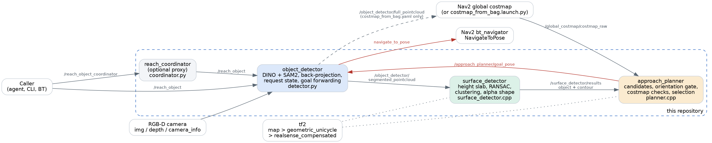

# Architecture overview

*High-level design of the `manipulation-approach` pipeline, developed for ergoCub. Each `##` section
stands on its own.*

---

## 1. What it is

Grasping starts before the arm moves: the robot has to stand at a place where the object is in reach
and the arms are free to work. This pipeline turns a text prompt into that stance.

**Input:** a text description of an object, RGB-D frames, TF, a global costmap, and the arm controllers.
**Output:** a `NavigateToPose` goal at the edge of the surface below the object, oriented toward the
object, refined while the robot drives.

**Key files**

- `object_detection/detector.py`: `object_detector`, the only node with Python ML dependencies. It
  runs detection and segmentation, owns the request state, and is the only sender of Nav2 goals.
- `object_detection/utils.py`: depth back-projection and ROS message builders.
- `object_detection/arm_interface.py`: YARP RPC client of the arm controllers, used to raise the hands.
- `object_detection/coordinator.py`: `reach_coordinator`, an optional action proxy.
- `surface_detection/src/surface_detector.cpp`: `surface_detector`, from point clouds to a contour.
- `approach_path_planning/src/planner.cpp`: `approach_planner`, from a contour to a goal pose.
- `surface_detector_interfaces/`: the `ReachObject` action and two message types.
- `approach_path_planning/launch/`: launch files for the whole stack.

**System overview**



Each stage is one node, and each stage narrows the problem:

| Stage | Input | Output | Page |
|---|---|---|---|
| Detect | Prompt + RGB-D | Object cloud + scene cloud | [Object detection](object_detection.md) |
| Find surface | Two clouds | Object position + surface contour | [Surface detection](surface_detection.md) |
| Plan | Contour + costmap | Goal pose | [Approach planning](approach_planning.md) |
| Navigate | Goal pose | Robot at the goal | [Request lifecycle](request_lifecycle.md) |

---

## 2. Foundational design choices

**A. The planner chooses a pose, not a path.**
"Approach" here means selecting where to stand. Path planning and control stay with Nav2. The
planner's only concern with paths is a reachability check, so the two systems keep separate
responsibilities and the pipeline works with any Nav2 configuration.

**B. The contour proposes, the costmap disposes.**
The surface contour comes from one camera frame, so it knows the surface but not the room, and part
of it may be only the edge of the camera's view. The costmap knows the room but not what the robot
wants. Candidates are therefore generated from the contour and judged against the costmap. This is
the pipeline's central safety property, and it is why it needs both inputs. See the
[worked examples](approach_planning.md#8-worked-examples).

**C. Nothing is mapped; everything is re-derived per frame.**
No node accumulates clouds or tracks the object. Every processed frame produces a fresh contour and
a fresh goal, so the estimate improves as the robot gets closer and sees more. The cost is that one
frame's view limits each estimate. See [known limitations](known_limitations.md).

**D. One owner for navigation.**
Three things could reasonably send goals: the planner, the detector and the coordinator. Only the
detector does. It holds the request state, so it alone can answer "is this goal still wanted?".
Previous versions had the planner call Nav2 directly. Now the planner is a stateless publisher whose
output nobody acts on outside a request.

**E. A camera stamp travels end to end.**
The goal pose carries the stamp of the depth frame it was computed from, through all three stages.
This costs nothing and lets the detector reject results computed before a request started, with no
extra protocol between nodes. See [request lifecycle](request_lifecycle.md#4-the-stamp-chain).

**F. Prompts instead of training.**
Grounding DINO takes free text, so a new object needs a new string and no training data. See
[object detection](object_detection.md#3-detection-grounding-dino).

**G. Expensive work runs only on demand.**
With no active request, `camera_callback` returns immediately. No inference runs and no clouds are
published, so the rest of the pipeline idles. The downside is that topics are silent when idle.

**H. Hands first, then close the gap.**
The robot cannot get close to a surface with its hands below or outside it, or the table edge traps the
arms. So the hands are raised from a distance, approach goals are held back until the arms confirm, and
stances that leave a hand off the surface are rejected. If the arms cannot be commanded, the request
aborts instead of approaching. See [raising the hands](request_lifecycle.md#2b-raising-the-hands).

---

## 3. Coordinate frames

Three frames carry the pipeline. Each stage works in the frame that makes its job simplest.

```text
map                       Z up, fixed. The costmap and all goals live here.
 └─ geometric_unicycle    Z up, at the robot base. Surface detection happens here.
     └─ realsense_compensated   Optical convention: X right, Y down, Z forward. Clouds are built here.
```

| Stage | Frame | Why |
|---|---|---|
| Back-projection | `camera_reference_frame` | Pixels map directly to optical coordinates. |
| Surface detection | `reference_frame` | Z is vertical, so "horizontal plane" and "height" are simple axis tests. |
| Planning | `map` | Same frame as the costmap and the Nav2 goal. |

Two requirements are easy to break when porting to another robot:

- **`camera_reference_frame` must be an optical frame.** The detector writes this name into the
  cloud header and overrides the frame in the depth message, while `utils.py` always produces
  optical coordinates (Z forward). A body-convention frame (X forward) gives a silently rotated
  cloud. Leave the parameter empty to use the depth message's own frame.
- **The base frame must be gravity-aligned with Z up.** The plane model searches for a normal along
  the Z axis of `reference_frame`. On a humanoid, a frame that follows the torso's tilt would tilt
  the search axis. `geometric_unicycle` is ergoCub's planar reference; `mobile_base_body_link` is the
  value noted for R1 in `detector.py`.

The name `map` is hard-coded in `planner.cpp`, and the planner does not read the costmap's frame. The
costmap's `global_frame` must be `map`.

---

## 4. Data flow

Messages between stages, with the transform each one performs:

| From | To | Topic | Content |
|---|---|---|---|
| Camera | `object_detector` | `/camera/rgbd/*` | Color, depth, intrinsics. |
| `object_detector` | `surface_detector` | `/object_detector/segmented_pointcloud` | Object and full scene clouds, in the optical frame, same stamp. |
| `surface_detector` | `approach_planner` | `/surface_detector/results` | Object XY centroid and maximum Z, plus closed contour, in `reference_frame`. |
| Nav2 costmap | `approach_planner` | `/global_costmap/costmap_raw` | Cost grid. |
| `approach_planner` | `object_detector` | `/approach_planner/goal_pose` | Best pose in `map`. |
| `object_detector` | Nav2 | `navigate_to_pose` (action) | Goal, after freshness and rate gates. |

The two clouds travel as one `SegmentedPointcloud` message, which spares the surface detector from
synchronising them.

The pipeline is a chain driven by the camera: each stage reacts to the previous one, and only the
costmap arrives independently. Slow stages therefore throttle what follows, and because stage queues
are ten messages deep, a slow surface detector also adds latency. See
[performance](surface_detection.md#7-performance).

---

## 5. Node lifecycles

`surface_detector` and `approach_planner` are lifecycle nodes. Their launch files configure and
activate them automatically.

| Transition | Effect |
|---|---|
| Configure | Reads parameters, creates subscribers and publishers. **Parameters are only read here**, so changing one at runtime has no effect until the node is reconfigured. |
| Activate | Enables the publishers. |
| Deactivate | Disables the publishers. |

The subscribers are plain subscribers, so a deactivated node keeps processing its inputs and only
stops publishing. `surface_detector` drops its subscriber on cleanup, but `approach_planner` does not.

`object_detector` and `reach_coordinator` are ordinary nodes.

Node names differ between launch and `ros2 run`. The launch files name the nodes `surface_detector`
and `approach_planner`, which the YAML files and the marker topic prefix depend on. Started without
them, the compiled defaults are `desk_detector_node` and `approach_planner_node`, so the YAML no
longer applies and the markers move to a different prefix. Use the launch files.

---

## 6. Summary of the guiding principles

1. Plan the stance; let Nav2 plan the path.
2. Trust the costmap over the contour.
3. Re-derive everything from the newest frame.
4. Give one node authority over navigation.
5. Carry the frame stamp through the chain, so that freshness is a simple comparison.
6. Compute only while somebody is asking.
