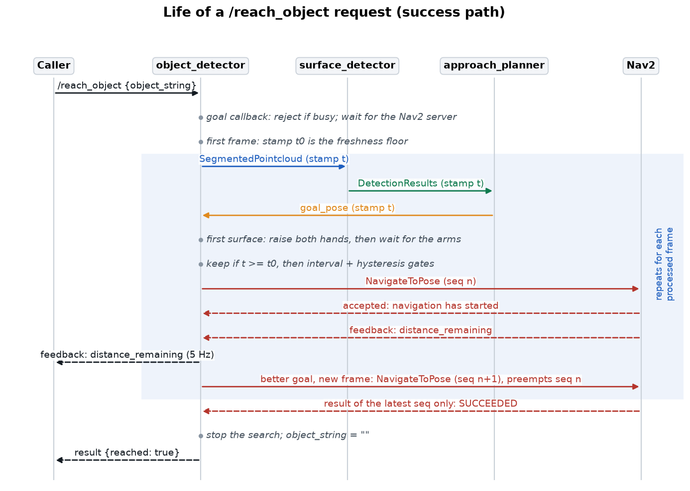
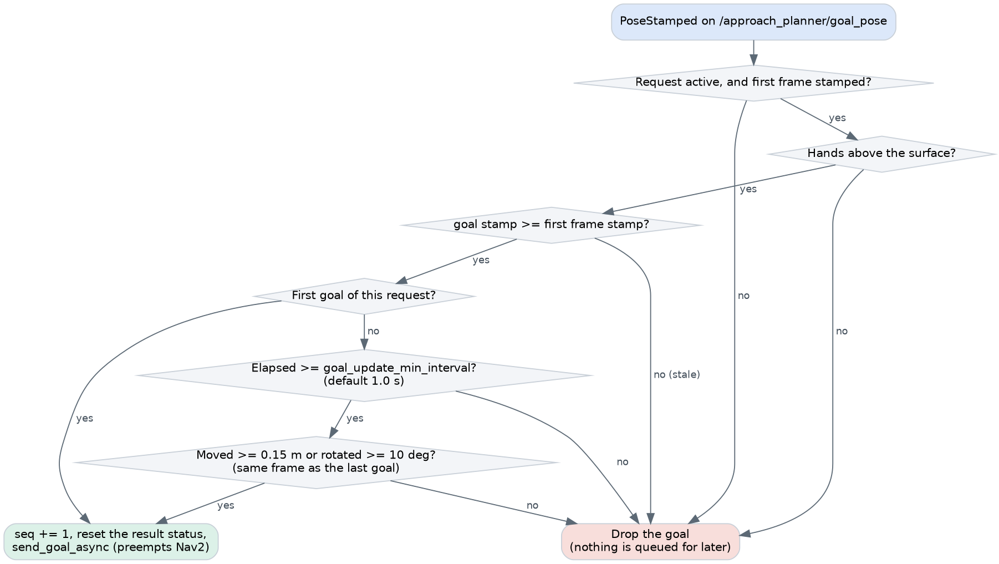

# Request lifecycle

How a `/reach_object` request runs from start to result: what the detector tracks, how it filters
goals, and how it ends. Code: the action and navigation methods of `object_detection/detector.py`,
and `object_detection/coordinator.py`.

---

## 1. Roles

`object_detector` is two things in one process: a perception node, and the pipeline's supervisor. The
second role holds all the pipeline's state. The surface detector and planner are stateless and run
identically whether a request exists or not. What gates them is simply that the detector stops
publishing clouds.

| State | Meaning |
|---|---|
| `object_string` | Current prompt. Empty means idle, and frames are skipped. |
| `_busy` | A request is running. |
| `_request_id` | Identifies the request, so late callbacks can detect they are outdated. |
| `_request_first_stamp` | Stamp of the first frame handled for this request. |
| `_last_sent_goal` | Last pose sent to Nav2, with the time it was sent. |
| `_nav_goal_seq` | Number of the latest goal sent. |
| `_nav_goal_handle` | Handle of the latest accepted goal, used to cancel it. |
| `_nav_started`, `_nav_goal_rejected`, `_nav_result_status` | Navigation outcome seen so far. |
| `_hands_state`, `_hands_error` | Progress of the hands raise stage. |

---

## 2. The success path



1. **Accept.** The goal callback rejects a request if `_busy` is set. Otherwise it sets `_busy`.
2. **Wait for Nav2.** Up to `nav_server_wait_timeout`.
3. **Start.** State is reset and `object_string` is set, which turns on frame processing.
4. **Wait for navigation to start.** For up to `navigation_start_timeout` from this moment, the
   request needs a goal accepted by Nav2. This budget has to cover detection, segmentation, surface
   detection, planning and goal acceptance, including every failed attempt along the way.
5. **Follow navigation.** A 5 Hz loop relays `distance_remaining` to the caller. Perception
   keeps running, so goals keep improving.
6. **Finish** when the latest Nav2 goal ends. Success stops the search and leaves the robot in place.

Between steps 3 and 4 the hands are raised, as described below. Waiting has no time limit after step 4. Once navigating, the request lasts as long as Nav2 does.

---

## 2b. Raising the hands

The hands must be above the surface before the robot gets close to it. The arm controllers have no
collision avoidance and move the hand in a straight line, so a hand raised from below the tabletop while
standing next to the table would hit it. The stage therefore runs at the start of the request, from the
navigation stop distance, before any approach goal is forwarded:

1. The first `DetectionResults` of the request (not older than the request) gives the surface height.
2. If the robot is closer to the contour than `hands_raise_min_distance`, the request **aborts**.
3. Each hand target is `(hand_forward_offset, ± hand_lateral_offset, surface height + hand_surface_clearance)`
   in the results frame, transformed to `arm_reference_frame` with TF.
4. `go_to_position` is sent to both arms through `arm_interface.py`, keeping the hand orientation.
5. The request loop polls `is_motion_done`. The stage ends when `hands_motion_duration` has passed and
   both arms report the end of the motion.

**Fail safe.** Goals are dropped until the stage ends, so the robot never approaches with the hands
down. Any problem aborts the request: a controller not running, a refused motion, no reply, or no end of
motion within `hands_motion_timeout` (which also covers a controller in its error state). If the request
ends during the motion, both arms get a `stop`. On success, the hands stay raised for the grasp, until a
[`/lower_hands`](#lowering-the-hands) request.

The stage runs once per request, and it does not read the current hand pose. Calling `/reach_object`
again while already close to the table with the hands raised aborts with "too close".

`navigation_start_timeout` keeps running during the stage, so it has to cover the arm motion too.

The controllers reply with the vocabs `ok` and `fail`. `yarp.Value.asBool()` is true for both, so
`arm_interface.py` compares the text. This was checked against a server generated from the controller's
own `service.thrift`.


### Lowering the hands

`/lower_hands` is a separate action of `object_detector`, with no goal fields. A request never lowers the hands by
itself, because the caller may want a grasp next. It runs when no `/reach_object` request is running, and the other
way around: the second request is rejected, since they would share the arms.

The hands cannot go straight home. `go_home` is a straight line to the pose the arm had when its controller started,
the controllers have no collision avoidance, and after an approach the hands are over the surface, so that line can
cross the edge. So the request has two stages:

1. **Retract.** It reads each hand with `get_pose`, and moves those ahead of `hand_retract_forward_offset` back to
   it, at the same height and on the same side. Reading the pose makes it work from anywhere, for example after a
   stopped motion or a restart of the detector.
2. **Home.** It calls `go_home` on both arms.

Each stage ends like the raise stage, with `hands_motion_duration` and `is_motion_done`, within
`hands_motion_timeout`. A cancel, a refused motion, a missing controller or a timeout stops both arms and leaves
them where they are. `go_home` is refused on R1 while the arm is moving.

---

## 3. Goal forwarding

The planner publishes a goal for every processed frame, and each new Nav2 goal preempts the previous
one. Forwarding them all would restart navigation constantly, so `planner_goal_callback` passes only
goals worth the interruption:



The two gates address different problems:

- **`goal_update_min_interval` (1 s)** limits the rate, so Nav2 has time to plan and move between
  goals.
- **`goal_update_min_distance` (0.15 m) and `goal_update_min_angle_deg` (10°)** form a deadband, a
  simple hysteresis. Frame-to-frame contour noise moves the goal slightly. Without the deadband, the
  robot would chase noise, and Nav2's goal checker might never settle. The comparison is against the
  **last goal sent**, so slow drift accumulates until it crosses the threshold.

A dropped goal is gone. A large change arriving within the interval is lost, and it takes effect only
if a later frame still shows it. Since frames keep coming, this costs one frame period.

---

## 4. The stamp chain

**The problem.** Topics can hold results from an earlier request. Queued frames may still be in the
surface detector when a new request for a different object begins. Forwarding such a goal would send
the robot toward the old object.

**The solution.** Each stage preserves the camera stamp:

```text
depth message stamp
  > PointCloud2 headers                 detector
  > object position header              surface_detector (stamp of the input cloud)
  > goal_pose header                    approach_planner (stamp of the object position)
```

The first frame handled for a request sets `_request_first_stamp`. Any goal stamped earlier predates
the request, and is dropped. This needs no request IDs in any message: a time comparison on standard
headers is enough, and the C++ nodes remain unaware of requests. In the synthetic runs, the stamp on
`goal_pose` matched the stamp of the input cloud exactly.

This is a check against the *start of the request* only. It does not limit a goal's age during a
request, so a backlog in the surface detector produces goals that pass the check while being
seconds old.

---

## 5. Stopping and cancellation

Every exit from a request runs through `stop_request`, in a `finally` block, so state is restored
even after an exception. It clears `object_string` and `_busy`. On any outcome other than success, it
also cancels the Nav2 goal.

**The in-flight goal race.** `send_goal_async` takes time. If a cancel arrives during that time, no
handle exists yet to cancel, and Nav2 would then accept a goal nobody wants. So
`nav_goal_response_callback` compares its captured `request_id` with the current state, and cancels
the goal itself if the request has ended. This also covers a new request starting in that window.

**Stale results.** Each goal has a sequence number. Feedback and results are recorded only if they
belong to the latest goal, so a preempted goal's terminal status cannot end the request.

---

## 6. Outcomes and failure modes

`reached` is true when Nav2 reports success for the latest goal. It says the robot arrived at the
pose, not that the object was confirmed in reach from there.

| Situation | Status | `error_msg` |
|---|---|---|
| Nav2 succeeded | Succeeded | Empty |
| Caller cancelled | Canceled | `Request cancelled` |
| No Nav2 server | Aborted | `Navigation action server navigate_to_pose not available` |
| No accepted goal in time | Aborted | `Timeout while starting the approach pipeline untill navigation` |
| Nav2 rejected the latest goal | Aborted | `Approach goal rejected by the navigation server` |
| Nav2 failed or cancelled it | Aborted | `Goal failed with status: <n>` (`5` canceled, `6` aborted) |
| Second request while busy | Rejected | No result. |
| Too close to raise the hands | Aborted | `Could not raise the hands: too close to the surface (...)` |
| A hand motion refused, or no reply | Aborted | `Could not raise the hands: ...` |
| No end of the hand motion in time | Aborted | `Timeout while raising the hands` |
| Arm controller not running | Aborted | `Arm controllers not available: left, right` |
| Through the coordinator, detector missing | Aborted | `Detector action server /reach_object not available` |
| Through the coordinator, second request | Aborted | `Detector rejected goal` |

The timeout message is generic: it covers every stage. The object not being seen, no plane, and no
valid candidate all look the same to the caller. To find out which stage failed, see the
[troubleshooting steps](tuning_and_troubleshooting.md#2-finding-the-failing-stage).

**If the object disappears mid-approach**, nothing happens: frames without detections publish nothing,
no new goals arrive, and the robot continues to the last goal.

---

## 7. The coordinator

`reach_coordinator` serves `/reach_object_coordinator` and forwards to `/reach_object`. It relays the
goal, feedback, result and cancellation, and adds no logic. It marks a seam where future orchestration
can go, for instance sequencing an approach and a grasp, without touching the detector.

It has no goal callback, so it accepts all goals, and a second concurrent goal fails only when the
detector rejects it. Goal handles are kept per upstream goal ID, so a cancel reaches the right
detector goal.

---

## 8. Concurrency

Heavy inference, action handling and navigation callbacks share one process, so the detector uses a
`MultiThreadedExecutor` with explicit callback groups:

| Callbacks | Group | Reason |
|---|---|---|
| Image and depth subscribers | Default (mutually exclusive) | `camera_callback` must not overlap itself. Holds a thread during inference. |
| Action server, `camera_info` | Reentrant | The execute loop blocks for the whole request, and cancel requests must run during it. |
| Nav2 action client | Own mutually exclusive | Per the code comment, `rclpy` action clients can process one goal response twice if run concurrently. |
| Planner goal subscriber | Own mutually exclusive | Goals must reach Nav2 in order. |

All shared state goes through `self._lock`, held only briefly and never during inference or ROS
calls, so slow perception cannot block cancellation.

The coordinator keeps its detector client in its own mutually exclusive group, for the same reason.
