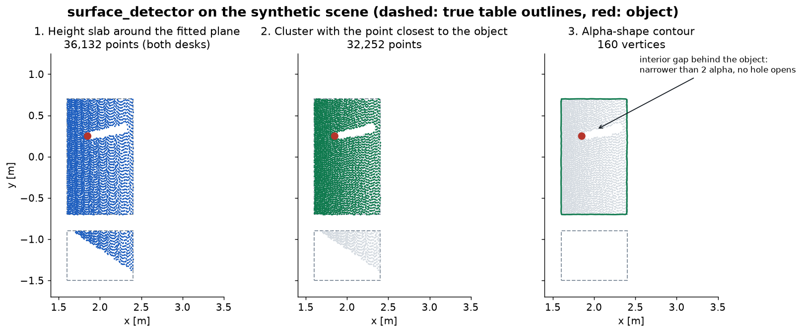
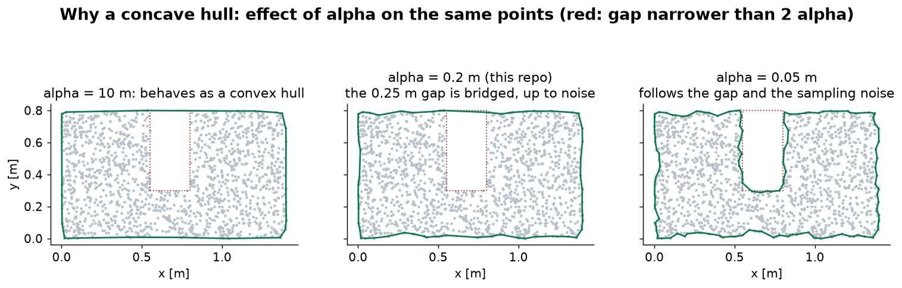

# Surface detection

From the object and scene clouds to the outline of the surface the object stands on.
Code: `cloud_callback` in `surface_detection/src/surface_detector.cpp`.

---

## 1. Pipeline

```text
SegmentedPointcloud (optical frame)
  1. Transform both clouds to reference_frame (Z up)
  2. Object statistics: XY centroid, min / mean / max height
  3. Height slab below the object
  4. Voxel downsampling (2 cm)
  5. RANSAC: dominant horizontal plane, gives its height
  6. Thicken (optional): all raw points within ± delta of that height
  7. Euclidean clustering: keep the cluster containing the point closest to the object
  8. Flatten to the plane height
  9. Alpha shape: keep the largest polygon
 10. Publish object position + closed contour
```

Each failure logs an error and drops the frame. Nothing is published, and the next frame retries.

The figure shows the real node's output for the synthetic baseline. Steps 3–6 find both desks, since
they have the same height, and clustering removes the wrong one.



---

## 2. Object statistics

The node works in `reference_frame`, where Z is height. From the object cloud it computes:

- The centroid. Its X and Y become the object position for the planner.
- `object_min_h`, `object_avg_h`, `object_max_h`. Z in the output message is the **maximum** height,
  which the planner uses only to draw markers. It is intended for a future hand height (`TODO` in
  `planner.cpp`).

---

## 3. The height slab

**Purpose.** A room contains many horizontal planes: floor, chairs, shelves. Searching only near the
object's height removes the floor, which is usually the largest plane in view and would otherwise
win the RANSAC vote.

The slab keeps scene points with:

```text
z_mean - delta - height_offset  <=  z  <=  z_mean
delta = (z_max - z_min) / 2
```

`z_mean - delta` estimates the base of the object, so the lower limit is `height_offset` (0.2 m)
below it. The upper limit stops at the object's mean height, which removes shelves above and the
upper half of the object.

In the synthetic scene the cup spanned 0.745–0.876 m, with a mean of 0.827 m, so the slab was
0.561–0.827 m. This contained the table at 0.75 m and excluded the floor.

Choosing `height_offset` is a balance. It must absorb errors in the object's base, such as a mask
that missed the bottom. It must also stay smaller than the distance to anything else horizontal
below the table, because a lower shelf with more visible points would win.

---

## 4. Plane fitting: RANSAC

**The problem.** Fitting a plane by least squares fails here, since the slab also holds the object,
other furniture, and noise, and these outliers would pull a global fit.

**The idea.** RANSAC (Fischler and Bolles, 1981) fits on minimal samples, not on all data:

```text
repeat for up to N iterations:
    sample 3 points, compute their plane
    count the inliers: points within d of the plane
keep the plane with the most inliers
```

If a fraction `w` of the points lies on the plane, one sample is all inliers with probability `w³`.
The probability of finding the plane at least once in `N` iterations is therefore:

```text
P = 1 - (1 - w³)^N
```

With `N = 200` (hard-coded) and `P = 0.99`, this needs `w ≥ 0.28`: the surface must supply at least
about 28 % of the voxels in the slab.

**The horizontal constraint.** The model is `SACMODEL_PERPENDICULAR_PLANE` with axis Z: the plane must
be perpendicular to Z, meaning that its *normal* is parallel to Z, within `ransac_eps`. The default
0.2 rad is 11.5°, which is generous enough to tolerate camera and base calibration errors while
rejecting walls and table sides.

**Why voxelise first.** A 2 cm voxel grid makes RANSAC fast and evens out density: a depth camera
samples near surfaces far more densely than far ones, and without voxelisation a small nearby
surface could outvote a large distant one. The voxel size is hard-coded (`m_voxel_size`).

---

## 5. Thickening and clustering

**Thickening** (`thicken_ransac: true`). RANSAC's output is mostly a height: the mean Z of its inliers
is `plane_height`. Thickening collects all raw scene points within `± delta_ransac_height` (3 cm) of
this height. It restores full resolution for a precise contour, and it recovers edge points that the
plane fit rejected. It is also by far the [most expensive choice](#7-performance) in this node.

**Euclidean clustering.** A height slab can still hold several surfaces at the same height: two
desks, or a desk and a windowsill. Clustering separates them by connectivity. It is region growing:
start from a point, repeatedly add every point within `cluster_tolerance` of the region, and start a
new cluster when no more can be added. A k-d tree answers the radius queries.

Two surfaces merge if any gap between them is smaller than `cluster_tolerance` (5 cm). Clusters
smaller than `min_cluster_size` are discarded.

**Choosing the cluster.** The cluster containing the single point closest to the object centre wins.
Using each cluster's centroid would be simpler but wrong: an object near the end of a long table is
far from that table's centroid, possibly farther than from a small cluster nearby.

---

## 6. The contour: alpha shapes

**The problem.** The planner needs an outline. A convex hull is simple, but it fills every concavity:
an L-shaped desk would become a triangle-like blob, and goals would land inside the notch's free
space with a wrong idea of where the edge is.

**The idea.** An alpha shape (Edelsbrunner et al., 1983) generalises the convex hull with a size
parameter. Imagine rolling a disc of radius `α` around the points: wherever it fits between points
without containing any, it carves away area.

PCL's `ConcaveHull` implements this through the Delaunay triangulation. For each triangle it compares
the circumradius `r` (radius of its circumscribed circle) with `α`:

- `r ≤ α`: keep the triangle. Its points are close enough to count as connected.
- `r > α`: remove it. It spans a gap.

The boundary is the set of edges between kept and removed triangles, or at the rim of the
triangulation.

**Reading `α`.** A triangle spanning a gap of width `g` has a circumradius of at least `g / 2`, so a
gap wider than `2α` is always carved. This repo hard-codes `α = 0.2` m. So the contour ignores
features below roughly 0.4 m wide, and it bridges occlusion shadows and depth dropouts below that
size.



Too large an `α` tends to the convex hull. Too small an `α` reproduces sampling noise and opens holes.
The value is a choice about the surface, not about noise, since it sets the smallest indentation the
robot can use.

**Flattening.** All points are set to `plane_height` first. PCL auto-detects the dimension from the
cloud's shape, and a 6 cm thick slab of points could otherwise yield a degenerate result.

**Largest polygon.** The hull may contain several polygons, for separate islands or holes. Area comes
from the shoelace formula, and only the largest survives, so the object's shadow never creates an
inner contour in the output.

The output marker repeats the first vertex at the end to close the loop, and the planner handles this
degenerate last segment explicitly.

---

## 7. Performance

Measured with the real node on the synthetic 640×480 scene, single-threaded, on one workstation:

| Scene | Points after thickening | Time per frame |
|---|---:|---:|
| Straight approach, 1 m from the edge | 32,641 | 0.45 s |
| Baseline, 1 m from the edge | 36,132 | 0.48 s |
| Large table | 51,281 | 0.64 s |
| Robot 0.6 m from the edge | 81,495 | 2.9 s |
| Robot 0.3 m from the edge | 131,407 | 10.7 s |
| Baseline, `thicken_ransac: false` | 3,243 | 0.02 s |
| Robot 0.3 m from the edge, `thicken_ransac: false` | 2,223 | 0.02 s |

Time grows much faster than the point count, and **the slowest case happens exactly where accuracy
matters most**, when the robot is close and the surface fills the image. A probable reason is that
each radius query in clustering returns more neighbours as density rises, so that cost scales with
both the count and the density. Stages were not timed individually.

Disabling thickening passes the voxelised inliers to the remaining steps. On the test scenes it gave
about 25–500× faster frames and a nearly identical contour (area 1.106 m² versus 1.116 m², true value
1.120 m²). The final goal moved by about 3 cm. `min_cluster_size` is a point count, so lower it at the same time: 200
voxels is 0.08 m², and 20 worked in these tests. To try it:

```yaml
thicken_ransac: false
min_cluster_size: 20
```

This is a recommendation to evaluate, not yet the default. It has only been tested on synthetic data
with clean edges. On real data, the raw cloud may still help where depth is sparse near edges.

A Release build does not help here: the time goes into PCL's precompiled library code. The times
above held for builds with and without `-DCMAKE_BUILD_TYPE=Release`.

The input queue holds 10 messages and the node has one thread, so frames that arrive during a slow
iteration wait and are processed late. Their goals carry old stamps but newer than `t0`, so the
[freshness check](request_lifecycle.md#4-the-stamp-chain) accepts them.

---

## 8. References

- M. A. Fischler and R. C. Bolles, *Random Sample Consensus: A Paradigm for Model Fitting with
  Applications to Image Analysis and Automated Cartography*, Communications of the ACM, 1981.
- H. Edelsbrunner, D. G. Kirkpatrick and R. Seidel, *On the Shape of a Set of Points in the Plane*,
  IEEE Transactions on Information Theory, 1983.
- R. B. Rusu, *Semantic 3D Object Maps for Everyday Manipulation in Human Living Environments*, PhD
  thesis, TU München, 2009 (Euclidean clustering).
